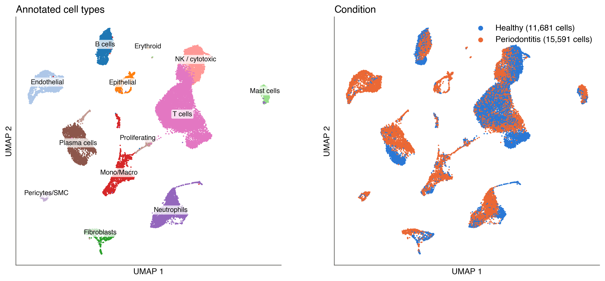
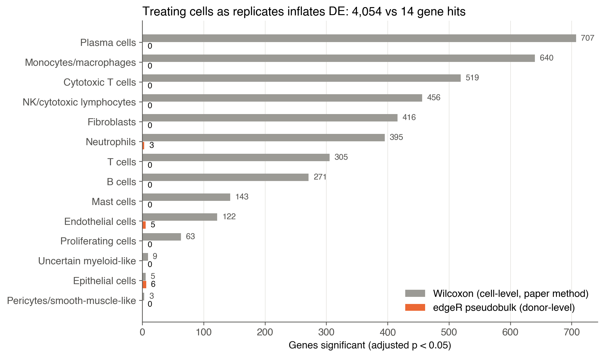
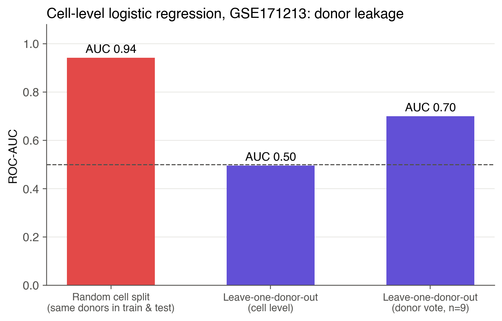

# GumDetective

**Which cells and genes change in periodontitis, and which of those changes replicate?**

Periodontitis is a chronic inflammatory disease that destroys the tissues that hold teeth in place. This project reanalyses a published single-cell RNA-seq study of human gingiva (GSE171213). It then tests each finding in three independent cohorts and asks whether machine learning adds anything over plain hypothesis testing.



---

## Key findings

| Question | Result |
|---|---|
| Can the published differential expression be reproduced? | Yes. The paper's cell-level Wilcoxon test gives **4,054** significant genes. When donors rather than cells are the unit of replication (edgeR pseudobulk), only **14** remain. Most of the published list comes from pseudoreplication. |
| Do cell-type proportions change? | **Plasma cells** (1.6 → 16.1 %) and **macrophages** (3.9 → 9.5 %) increase in periodontitis, which replicates in an independent cohort (FDR 0.02). The endothelial ↑ / T-cell ↓ shifts **reverse** between cohorts and are not supported. |
| Which genes replicate? | **SELL, THBS1, CYR61, CXCL6** are up in all three cohorts. **39 genes** are up in disease across the discovery scRNA, validation scRNA and bulk cohorts. |
| Which pathways? | NF-κB signalling, osteoclast differentiation and antibody secretion go up. Extracellular matrix and epithelial programmes go down. |
| Does ML beat hypothesis testing? | Barely. In patient-grouped CV, the best single t-test gene reaches AUC **0.88**, a 50-gene DE score **0.91**, logistic regression / linear SVM **0.93** and random forest 0.91. On an external cohort of new patients, AUC is **0.90–0.99**. |
| Can single cells classify disease? | Not with 9 donors. A random cell split gives AUC **0.94**, but holding out whole donors drops it to **0.50**: the model learns donor identity, not disease. |

<p align="center">
  
  
</p>

---

## Datasets

| GEO accession | Type | Samples | Role |
|---|---|---|---|
| [GSE171213](https://www.ncbi.nlm.nih.gov/geo/query/acc.cgi?acc=GSE171213) | scRNA-seq, gingiva | 4 healthy vs 5 periodontitis donors (27,272 cells after QC) | Discovery |
| [GSE164241](https://www.ncbi.nlm.nih.gov/geo/query/acc.cgi?acc=GSE164241) | scRNA-seq, gingiva | 13 healthy (GM) vs 8 periodontitis (PD) samples from 5 donors | Single-cell validation |
| [GSE10334](https://www.ncbi.nlm.nih.gov/geo/query/acc.cgi?acc=GSE10334) | Affymetrix HG-U133 Plus 2.0 | 247 biopsies from 90 patients | Bulk validation and ML training |
| [GSE16134](https://www.ncbi.nlm.nih.gov/geo/query/acc.cgi?acc=GSE16134) | Affymetrix HG-U133 Plus 2.0 | 63 independent biopsies from 29 patients | External ML test |

> **Hidden duplicates:** GSE16134 re-deposits 245 GSE10334 arrays under new sample IDs, so matching by ID finds no overlap. `17_prepare_bulk_validation.py` detects them by expression-profile correlation (r > 0.8, against about 0.5 for unrelated arrays). Only patients with no duplicated array are kept for the external test.
>
> The BioProject PRJNA718775 is the same study as GSE171213 and is not an independent cohort.

---

## Repository layout

```
scripts/                 analysis pipeline, numbered in run order (R and Python)
results/
  tables/                DE results, composition tests, enrichment, ML metrics (CSV / JSON)
  figures/               QC, clustering and annotation plots
  figures/final/         summary figures (fig1–fig9)
data/                    not tracked; see "Reproducing the analysis"
```

## Pipeline

| Step | Script | What it does |
|---|---|---|
| 01–02 | `01_inspect_data.R`, `02_preview_counts.R` | Inspect the downloaded GEO files |
| 03–08 | `03_convert_counts.py` … `08_export_for_seurat.py` | Convert to sparse format, select healthy and periodontitis donors, compute QC metrics, filter cells per donor, export for Seurat |
| 09–11 | `09_seurat_clustering.R` … `11_annotate_clusters.R` | Normalise, cluster, UMAP, find marker genes, annotate 15 cell types |
| 12–13 | `12_pseudobulk_de.R`, `13_plot_candidate_genes.R` | Donor × cell-type pseudobulk DE (edgeR quasi-likelihood) |
| 14–15 | `14_compare_paper_qc.py`, `15_paper_style_de.R` | Reproduce the original paper's QC and cell-level Wilcoxon DE |
| 16 | `16_cell_type_composition.R` | Per-donor cell-type proportions, Mann–Whitney with BH correction |
| 17 | `17_prepare_bulk_validation.py` | Parse bulk cohorts, collapse probes to genes, detect GSE16134 duplicates |
| 18 | `18_export_for_ml.R` | Export expression, metadata and pseudobulk for Python |
| 19 | `19_pathway_enrichment.py` | GO Biological Process and KEGG enrichment (Enrichr) per cell type |
| 20 | `20_tissue_pseudobulk_de.R` | Tissue-level pseudobulk DE (the single-cell analogue of a biopsy) |
| 21 | `21_bulk_validation_and_ml.py` | Bulk DE, signature tests, hypothesis-testing baselines vs LR / SVM / RF, external test |
| 22 | `22_validation_scRNA_GSE164241.R` | QC, clustering and annotation of the independent scRNA cohort |
| 23 | `23_cross_dataset_and_scRNA_ml.py` | Cross-cohort replication; single-cell classification and leakage |
| 24 | `24_make_figures.py` | Summary figures in `results/figures/final/` |

## Reproducing the analysis

1. **Download the data from GEO** into `data/`:
   - `data/raw/GSE171213_AllSample.counts.tsv.gz` (GSE171213 supplementary file)
   - `data/external/GSE10334_series_matrix.txt.gz` and `data/external/GSE16134_series_matrix.txt.gz`
   - `data/external/GPL570.annot.gz` (platform annotation)
   - `data/external/GSE164241/`: the 10x `barcodes`, `genes`/`features` and `matrix` files for the GM and PD samples
2. **Install dependencies:**
   - R ≥ 4.3 with `Seurat` (v5), `edgeR`, `Matrix`, `dplyr`, `tidyr`, `ggplot2`
   - Python ≥ 3.10 with `numpy`, `scipy`, `pandas`, `scikit-learn`, `statsmodels`, `matplotlib`, `gseapy`
3. **Run the scripts in numerical order** from the project root, for example:
   ```bash
   Rscript scripts/09_seurat_clustering.R
   python3 scripts/21_bulk_validation_and_ml.py
   ```
   Intermediate objects go to `data/processed/`. Tables and figures go to `results/`.

## Methods notes

- **QC:** per-donor caps on genes and UMIs to limit doublets, plus a mitochondrial fraction < 25 %. This leaves 27,272 of 45,191 cells (11,681 healthy, 15,591 periodontitis).
- **Differential expression:** the donor is the unit of replication. Counts are summed per donor (and per cell type) and tested with edgeR quasi-likelihood. Cell-level Wilcoxon is run only to reproduce the original paper.
- **Classification:** all cross-validation splits are grouped by patient (`StratifiedGroupKFold`, 5-fold × 5 repeats), so no patient appears in both training and test. Hypothesis-testing baselines (best single gene, mean DE-gene score) are reported next to the ML models.
- **Single-cell classification:** evaluated with leave-one-donor-out, plus a random-cell split to quantify leakage.

## Limitations

- Few donors in the single-cell cohorts (4 + 5 and 13 + 5).
- Ambient RNA and doublets are not explicitly removed.
- The external bulk test set contains only 5 healthy samples.
- The 3 post-treatment donors in GSE171213 were too few for formal testing.

## References

- Chen *et al.* (2022). Single-cell RNA sequencing of human periodontitis. *Theranostics*. (GSE171213)
- Williams *et al.* (2021). Human oral mucosa cell atlas. *Cell*. (GSE164241)
- Demmer *et al.* (2008). *J Periodontol*. (GSE10334)
- Kebschull *et al.* (2014). *J Dent Res*. (GSE16134)
- Squair *et al.* (2021). Confronting false discoveries in single-cell differential expression. *Nat Commun*.

## Authors

Ishaan Srivastava (23B2187) · Neha Kanwadiya (23B1852)
