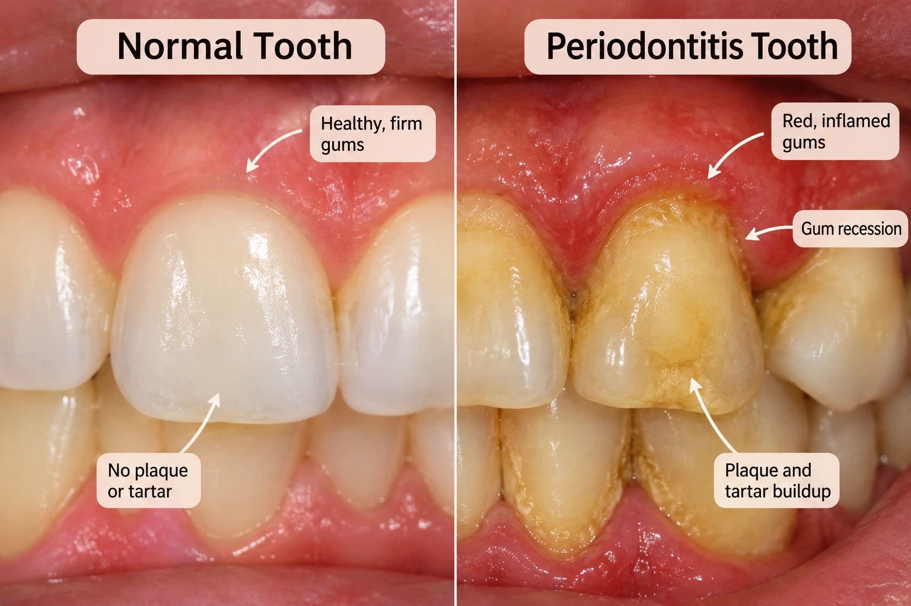

# GumDetective

**Periodontitis at single-cell resolution: what changes, and what replicates?**

<p align="center">
  
</p>

Periodontitis is a chronic inflammatory disease that destroys the gum tissue and bone holding the teeth. This project uses single-cell and bulk RNA data to find which cells and genes change in diseased gums, and tests every finding in three independent cohorts. All statistics treat the donor or patient as the unit of analysis, not the individual cell.

## Hypothesis and verdict

> Periodontitis is associated with changes in periodontal cell populations and gene expression.

| Part | Verdict | Evidence |
|---|---|---|
| Gene expression changes | Supported | 9,929 genes change in 247 biopsies; 39 genes up in all three cohorts; classifiers reach AUC 0.93 |
| Cell populations change | Partly supported | Plasma cells and macrophages increase in both single-cell cohorts; four other shifts reverse |
| Single-cell signature carries over to bulk tissue | Weak | AUC 0.63, not confirmed in the external cohort |

## Key results

1. **Cells are not replicates.** The original paper's cell-level test gives 4,054 hits; donor-level pseudobulk gives 14.
2. **Cell composition.** Plasma cells and macrophages rise in both single-cell cohorts. The endothelial and T-cell trends from the discovery cohort reverse.
3. **Candidate genes.** THBS1, CYR61 and CXCL6 replicate in every cohort. The neutrophil genes do not.
4. **Pathways.** Inflammation goes up and epithelial structure goes down; neutrophils show NF-κB and osteoclast pathways.
5. **Bulk tissue.** 9,929 genes differ between diseased and healthy sites, but the single-cell signature alone separates them weakly (AUC 0.63).
6. **Tests before ML.** A simple DE gene score reaches AUC 0.91; logistic regression and SVM reach 0.93, and 0.90–0.99 on 29 new patients.
7. **Donor leakage.** A cell-level classifier scores 0.94 with a random split but 0.50 on unseen donors.

## Data

All datasets are public on GEO and are not stored in this repository.

| Role | Dataset | Type | Samples |
|---|---|---|---|
| Discovery | [GSE171213](https://www.ncbi.nlm.nih.gov/geo/query/acc.cgi?acc=GSE171213) | scRNA-seq | 4 healthy, 5 periodontitis donors (27,272 cells) |
| Validation | [GSE164241](https://www.ncbi.nlm.nih.gov/geo/query/acc.cgi?acc=GSE164241) | scRNA-seq | 13 healthy, 5 periodontitis donors |
| Validation and ML | [GSE10334](https://www.ncbi.nlm.nih.gov/geo/query/acc.cgi?acc=GSE10334) | Microarray | 247 biopsies, 90 patients |
| External test | [GSE16134](https://www.ncbi.nlm.nih.gov/geo/query/acc.cgi?acc=GSE16134) | Microarray | 63 samples, 29 patients |

GSE16134 re-uploads 245 GSE10334 arrays under new IDs; script 17 detects and removes them so the external test is independent.

Place the files as follows:

```
data/raw/GSE171213_AllSample.counts.tsv.gz
data/external/GSE10334_series_matrix.txt.gz
data/external/GSE16134_series_matrix.txt.gz
data/external/GPL570.annot.gz
data/external/GSE164241/    10x files (*_matrix.mtx.gz, *_barcodes.tsv.gz, *_features.tsv.gz)
```

## Pipeline

Run the scripts in `scripts/` in numerical order from the project root.

| Scripts | Step |
|---|---|
| 01–08 | Select donors, quality control, filtering |
| 09–11 | Normalisation, clustering, UMAP, cell-type labels (Seurat) |
| 12, 20 | Donor-level pseudobulk differential expression (edgeR) |
| 13–16 | Candidate gene plots, reproduction of the paper's analysis, composition tests |
| 17, 22 | Bulk cohort preparation and duplicate check; GSE164241 validation |
| 18–19 | ML export; GO/KEGG pathway enrichment |
| 21, 23 | Bulk tests vs logistic regression, SVM and random forest; cross-cohort replication; leakage test |
| 24 | Final figures |

## Results in this repository

All outputs are included, so the findings can be read without running the pipeline.

**Figures** (`results/figures/final/`)

| File | Shows |
|---|---|
| `fig1_umap.png` | Cell types and condition on UMAP |
| `fig2_composition_two_cohorts.png` | Per-donor cell proportions in both single-cell cohorts |
| `fig3_de_method_comparison.png` | Cell-level vs donor-level DE hits |
| `fig4_candidate_replication.png` | The 14 candidate genes across three cohorts |
| `fig5_enrichment.png` | Enriched pathways by cell type |
| `fig6_bulk_volcano.png` | Bulk biopsy volcano plot |
| `fig7_ml_bulk_comparison.png` | Statistical tests vs ML performance |
| `fig8_roc_bulk.png` | ROC curves |
| `fig9_leakage.png` | Random split vs held-out donors |

**Tables** (`results/tables/`)

| File | Contents |
|---|---|
| `DE_all_cell_types.csv` | Donor-level DE for all cell types |
| `composition_two_scRNA_cohorts.csv` | Cell composition tests |
| `candidate_genes_replication.csv` | Candidate genes in three cohorts |
| `replicated_genes_three_cohorts.csv` | The 39 shared genes |
| `signature_validation_bulk.csv` | Single-cell signatures tested in bulk |
| `ml_bulk_cv_summary.csv`, `ml_bulk_external_test.csv` | ML performance |

## Environment

- R 4.x with Seurat 5 and edgeR
- Python 3 with pandas, scipy, scikit-learn, statsmodels, matplotlib and gseapy

## Limitations and next steps

The discovery cohort is small (4 vs 5 donors), the external test has only 5 healthy samples, and the cohorts differ in sampling and technology. Next steps are ambient-RNA and doublet removal, more donors, analysis of post-treatment samples, and protein-level validation of THBS1, CYR61 and CXCL6.
